# Team Invictus — Vehicle Identification & Traceability (AIML-01)

[](https://hackasol.devpost.com/)
[](https://www.python.org/)
[](https://pytorch.org/)
[](https://docs.ultralytics.com/)
[](https://fastapi.tiangolo.com/)
[](https://react.dev/)
[](https://tailwindcss.com/)
[](https://developer.nvidia.com/)

An end-to-end computer vision and deep learning system built for real-world traffic surveillance, forensic vehicle traceability, and continuous multi-vehicle tracking across complex urban intersections and highways.

---

## 📑 Living Documentation Suite

To maintain transparency and a persistent engineering audit trail throughout Hack-a-Sol 5.0, three living documentation files track our progress:

- **[challanges.md](challanges.md)**: Real engineering hurdles encountered during development—compute bottlenecks, motion-blur vs. background clutter trade-offs, occlusion ID splits, perspective scale growth, dense-lane identity jumping, overhead gantry bar occlusions, bumper-edge plate clipping, and frame extraction latency.
- **[solutions.md](solutions.md)**: Technical specifications, mathematical formulations, algorithms, and empirical verification results for each resolved challenge.
- **[changes.md](changes.md)**: Chronological changelog with exact timestamps documenting repository milestones, pipeline iterations, and test runs.

---

## 🎯 Problem Statement (Track AIML-01)

Traffic monitoring and law enforcement agencies face severe challenges when tracking vehicles through congested CCTV feeds:
1. **Broken Identities**: Vehicles passing behind buses or crossing traffic disappear temporarily, causing standard trackers to assign new identity numbers when they emerge.
2. **Identity Jumping**: In dense parallel lanes, tracks frequently hop onto adjacent vehicles of similar color or size.
3. **Environmental Occlusions**: Overhead gantry poles, traffic lights, and tree branches momentarily clip bounding boxes, fragmenting vehicle traces.
4. **Scale Dynamics**: Vehicles approaching fixed CCTV cameras grow up to $2\times$ in size, defeating naive scale-matching thresholds.
5. **Partial / Occluded License Plates**: CCTV motion blur, dirt, low resolution, and perspective skew result in incomplete character sequences (e.g. `MH12??1432`).

**Invictus Vehicle Trace** delivers a unified end-to-end solution: a high-precision CV tracking pipeline connected directly to a probabilistic RTO registry matching engine and an investigator-grade forensic surveillance dashboard.

---

## 🏗️ End-to-End System Architecture

```mermaid
flowchart TD
    subgraph Stage1["Stage 1: High-Resolution CV & Tracking Pipeline"]
        VideoInput["Input CCTV Video (.mp4)"] --> Detection["High-Res YOLO26s Inference\n(imgsz=1280, conf=0.20 on RTX 3050 GPU)"]
        Detection --> Filter["COCO Vehicle Filtering\n(motorcycle, bicycle, car, bus, truck)"]
        Filter --> BoTSORT["Fixed-CCTV BoT-SORT Tracking\n(gmc_method: none, track_buffer: 90, match_thresh: 0.72)"]
        BoTSORT --> Splitter["Pre-Stitch Jump Splitter (splitter.py)\n- Class switch rejection\n- Sustained scale jumps (>2.2x)\n- Overhead bar dip/recovery"]
        Splitter --> Stitcher["Trajectory & Central-Body Stitcher (stitcher.py)\n- Central body crop ([0.18-0.82]H, [0.12-0.88]W)\n- Velocity vector projection (lateral_err <= 65px)\n- Footprint allowance (>=60px)\n- Perspective growth tolerance (<=2.1x)\n- Disjoint-Set Union (DSU) clustering"]
        Stitcher --> PostFilter["Post-Tracking Clutter Pruning\n(min_frames=15, min_box_area=1200px)"]
        PostFilter --> BestCrop["Laplacian Sharpness Best-Crop Selector\n(crop_selector.py)"]
        BestCrop --> Stage1Exports["Stage 1 Deliverables\n- Annotated Video with unified IDs\n- Forensic tracks_summary.json\n- Frame-by-Frame track_history.json\n- Laplacian Sharpest Crops"]
    end

    subgraph Stage2["Stage 2: Target Vehicle Selection & Three-Tier Crop Extraction"]
        Stage1Exports --> Selection["Interactive / CLI Target Selection\n(scripts/run_tracking.py --target-id <ID> / --interactive)"]
        Selection --> CropExtractor["Three-Tier Crop Extractor (crop_extractor.py)\n- vehicle_crops_raw/ (native px, 8% margin)\n- vehicle_crops_unenhanced/ (Lanczos4 upscaled)\n- vehicle_crops_enhanced/ (bilateral + CLAHE + unsharp)"]
        CropExtractor --> Manifest["crop_manifest.json (100% dimension parity across tiers)"]
    end

    subgraph Stage22["Stage 2.2: Dual-Detector License Plate Cropping & Dynamic Readability Selection"]
        Manifest --> DualDetector["Dual Plate Detectors (cv_pipeline/plate_detector.py)\n- Detector A: Custom Indian YOLO26s (models/yolo26s_plate_best.pt)\n- Detector B: Global YOLOv9-s ONNX (open-image-models)"]
        DualDetector --> GeomFilter["Plate Geometry Filter\n- AR in [0.85, 6.5], Area <= 45% crop"]
        GeomFilter --> CrossVerify["Spatial Cross-Verification & Conflict Resolution\n- DUAL_VERIFIED (IoU >= 0.35, 1.25x bonus)\n- CONFLICT_RESOLVED_CUSTOM / GLOBAL (IoU < 0.35)\n- 100% Balanced Detection Math"]
        CrossVerify --> BorderGuard["Border-Truncation Guard\n- Crop edge <= 2 native px\n- Video outer boundary <= 6px\n- Exit AR drop < 0.75 * median_ar within 5% border\n- Prevents cut-off exit frames"]
        BorderGuard --> LanczosZoom["Pure Lanczos4 Enlargement\n- Min width 320px or height 120px (capped 4.0x)\n- Zero post-filters, 100% unenhanced/enhanced parity"]
        LanczosZoom --> ReadabilityGate["Outlier-Resilient Dynamic Readability Gate\n- 90th percentile (p90) score anchor (thresh = 0.45 * p90)\n- Eliminates glare/noise outlier clipping\n- Capped at 60 evenly spaced frames\n- Exports plate_manifest.json"]
        ReadabilityGate --> CVBridge["CV Bridge & Plate OCR / VLM\n- Plate OCR extraction with '?' wildcards\n- Dominant color extraction (HSV)\n- Body type mapping\n- TrackSummary packaging"]
        CVBridge --> FastAPI["FastAPI Backend (backend/main.py)"]
        FastAPI --> Matcher["Probabilistic Matcher (backend/matcher.py)\n- Weighted Composite Scoring\n  (Plate 50%, Colour 25%, Body 25%)\n- Visual confusion matrix (8<->B, 0<->D, 1<->I)\n- Wildcard slot handling for partial plates\n- Witness testimony bias modifier\n- Calibrated 'No Confident Match' gate (<65%)"]
        FastAPI --> RegistryDB[("Synthetic RTO Registry\n1,000+ Vehicles with HSRP standard")]
    end

    subgraph Stage3["Stage 3: Investigator Forensic Dashboard"]
        FastAPI --> ReactApp["React 19 Surveillance Dashboard\n- Studio Bento Grid Layout\n- Interactive 3D HSRP Plate Inspection\n- Video Player with synchronized track overlays\n- Evidence Gallery with Lightbox Modal\n- 4 One-Click Demo Presets\n- One-Click Forensic Dossier PDF Export"]
    end
```



---

## 🚀 Key Technical Innovations

### 1. Computer Vision Pipeline (`cv_pipeline/`)
- **GPU-Accelerated Throughput**: Built on PyTorch 2.6.0 with CUDA 12.4 on an NVIDIA GeForce RTX 3050 Laptop GPU, achieving **45–60 FPS** at full 1080p resolution.
- **Pre-Stitch Anomaly Splitter (`splitter.py`)**: Eliminates identity jumping across lanes by immediately splitting tracks if a vehicle switches between two-wheeler and four-wheeler classes or suffers sustained scale jumps, while preserving 1-frame overhead bar occlusion dips.
- **Trajectory-Projected & Central-Body Stitcher (`stitcher.py`)**:
  - Compares the inner $64\% \times 76\%$ crop of each vehicle to avoid roof-level gantry bars and ground shadows.
  - Projects reappearance position using forward velocity $\vec{v}_A$, strictly enforcing $\text{lateral\_err} \le 65\text{px}$ to eliminate cross-lane swaps.
  - Accommodates boundary expansions ($\ge 60\text{px}$) when emerging from occlusions without tripping velocity ceilings.
  - Accommodates natural camera approach growth up to $2.1\times$ for identical vehicle classes.
- **Automated Forensic Contact Sheet (`grid_generator.py`)**: Generates high-resolution overview contact sheets (`tracks_grid.jpg`) featuring the sharpest Laplacian frame crop, unique master ID, vehicle class, and active timestamp for every tracked vehicle.
- **Dual-Detector Plate Localization & Dynamic Readability Selection (`plate_detector.py`)**:
  - **Ensemble Localization**: Merges Custom fine-tuned Indian plate YOLO26s with Global YOLOv9-s ONNX with explicit conflict resolution (`CONFLICT_RESOLVED_CUSTOM` / `GLOBAL`) and 100% mathematically balanced accounting.
  - **Border-Truncation Guard**: Rejects frame-exit and edge-clipped plates ($\le 2$ native px from crop border, $\le 6$ px from video outer frame, or AR drop $< 0.75 \times \text{median\_ar}$ near borders), preventing cut-off exit frames from dominating selection.
  - **Pure Lanczos4 Enlargement**: Scales small plates cleanly to $\ge 320\text{w}$ or $\ge 120\text{h}$ with zero post-processing filters, preserving exact dimensional parity between unenhanced and enhanced crops.
  - **Outlier-Resilient Dynamic Gate**: Replaces peak anchors with a $p90$ score anchor ($0.45 \times p90$), preventing single glare frames from starving OCR of readable candidates.

### 2. Probabilistic Matching Engine (`backend/matcher.py`)
- **Weighted Multi-Factor Scoring**:
  $$\text{Composite Score} = 0.50 \cdot S_{\text{plate}} + 0.25 \cdot S_{\text{colour}} + 0.25 \cdot S_{\text{body}}$$
- **OCR Confusion Matrix & Wildcard Syntax**:
  - Handles blurred or occluded characters (`?`) without penalizing unknown slots.
  - Integrates visual confusion penalties for common CCTV OCR errors: $8 \leftrightarrow B$, $0 \leftrightarrow D \leftrightarrow O$, $1 \leftrightarrow I \leftrightarrow T$, $5 \leftrightarrow S$, $2 \leftrightarrow Z$.
  - Indian RTO format compliance validation (State code + RTO district + Series + 4-digit numeric sequence).
- **Calibrated "No Confident Match" Safety Gate**:
  - Drops matches scoring below $65\%$ into a quarantined investigative bucket, preventing false positive accusations.
- **Investigator Witness Bias Modifier**:
  - Accepts partial eye-witness hints (e.g. "I remember MH12DE...") to dynamically adjust character slot priors.

### 3. Investigator Dashboard (`frontend/`)
- **Studio Bento Layout**: High-density operational cockpit for forensic analysts.
- **Interactive 3D HSRP Plate**: Full interactive rendering of India's High Security Registration Plate with IND badge and laser security code.
- **Lightbox Evidence Modal**: Full-resolution inspection of vehicle crops and detection bounding boxes.
- **One-Click Forensic Dossier**: Generates complete, court-ready printable/exportable forensic reports.

---

## 📊 Benchmark Results & Live Scenarios

| Scenario / Video | Resolution & FPS | Track Count | Verified Target Outcomes |
| :--- | :---: | :---: | :--- |
| **`activa_signal.mp4`** (Urban Intersection) | 1080p @ 30 FPS | 29 | Moving white Activa maintains **Track 27** across the entire intersection crossing (`[27, 38, 51]`); stationary Activa maintains **Track 4** across all 300 frames. Matched to **MH12DE1432** (Honda Activa 6G, 99.6% confidence). |
| **`highway_traffic.mp4`** (Multi-Lane Highway) | 1080p @ 30 FPS | 88 | Vehicles passing under horizontal overhead gantry bar cleanly stitch (`39-66`, `49-95`, `55-90`, `56-87`, `61-91-93`, `63-96-98`). Parallel cross-lane swaps strictly rejected. Matched to **UP16CD4821** (Mahindra Scorpio). |
| **`simple_traffic_30s.mp4`** (General Traffic Stress Test) | 1080p @ 30 FPS | 144 | 57 merge events consolidated across 34 multi-segment tracks; zero ID jumping across cars, trucks, buses, and motorcycles. |
| **`activa_signal.mp4` (Stage 2.2 Plate Detection)** | 1080p @ 30 FPS | Track 27 | 63 plates detected, 3 border-truncated rejected (Frames 255, 256, 260). Last selected Frame 254 fully intact ($231\times 120\text{px}$). 26 top paired crops selected. 100% math balance ($58=58, 55=55$). |
| **`simple_traffic_30s.mp4` (Stage 2.2 Plate Detection)** | 1080p tracking $\to$ 4K crop | Track 2 | 184 plates detected, 8 border-truncated rejected (Frame 187 excluded). Last selected Frame 186 fully intact ($320\times 91\text{px}$). 52 top paired crops selected. 100% math balance ($76=76, 177=177$). |
| **Visual OCR Confusion Stress Test** | CCTV Blur Test | 1 | Observed `DL03C880?1` (Red SUV) resolved to `DL03CB8051` (Tata Nexon) with 99.4% confidence via $8 \leftrightarrow B$ OCR confusion tolerance. |
| **Calibrated Unregistered Gate Test** | Unregistered Probe | 1 | Observed `GJ05XX9999` correctly triggers **No Confident Match** gate (top score 60.5% < 65% threshold). |

---

## 🛠️ Usage & Execution

### 1. Prerequisites
- Python 3.10+ (CUDA 12.x GPU recommended for real-time tracking, CPU supported for inference/backend)
- Node.js 18+ and npm
- Virtual environment with dependencies installed:
  ```bash
  pip install -r requirements.txt
  ```

### 2. Running Tracking & Vehicle Crop Extraction (Stage 1 & Stage 2)
```bash
# 1. Run tracking and interactively select a vehicle from the terminal
python scripts/run_tracking.py --video data/clips/activa_signal.mp4 --output-dir outputs --interactive

# 2. Run tracking and directly extract all crops for a target vehicle (e.g. Track 27) with 5% safety margin padding
python scripts/run_tracking.py --video data/clips/activa_signal.mp4 --output-dir outputs --target-id 27 --padding 0.05

# 3. Instantaneously extract crops reusing existing tracking data (<50ms, no re-tracking)
python scripts/run_tracking.py --video data/clips/activa_signal.mp4 --output-dir outputs --reuse-tracking --target-id 27

# 4. Run Stage 2.2 Dual-Detector Plate Detection & Dynamic Selection on target track
python scripts/run_tracking.py --video data/clips/activa_signal.mp4 --reuse-tracking --target-id 27
python scripts/run_tracking.py --video data/clips/simple_traffic_30s.mp4 --crop-video data/clips/simple_traffic.mp4 --reuse-tracking --target-id 2

# 5. Run on highway traffic with custom trajectory & lateral alignment thresholds
python scripts/run_tracking.py \
  --video data/clips/highway_traffic.mp4 \
  --output-dir outputs/highway_traffic \
  --output-video highway_traffic_tracked.mp4 \
  --device 0 \
  --imgsz 1280 \
  --conf 0.20 \
  --max-gap 2.5 \
  --max-lateral-err 65.0
```

### 3. Running the FastAPI Backend
```bash
# Seed the synthetic RTO database (if needed)
python -m backend.seed_data

# Start the FastAPI server
uvicorn backend.main:app --host 0.0.0.0 --port 8000 --reload
```
API Documentation will be live at `http://localhost:8000/docs`.

### 4. Running the Frontend Dashboard
```bash
cd frontend
npm install
npm run dev
```
Dashboard will be accessible at `http://localhost:5173`.

### 5. Running the Verification Test Suite
```bash
# Run comprehensive verification tests on matcher, scoring, and API endpoints
python scripts/test_matcher.py

# Build production frontend
cd frontend && npm run build
```

---

## 🔌 API Endpoints Reference

| Method | Endpoint | Description |
| :--- | :--- | :--- |
| `GET` | `/api/health` | Healthcheck and registry database connectivity status |
| `GET` | `/api/demo-scenarios` | Lists the 4 curated instant forensic investigation presets |
| `POST` | `/api/videos/scan` | Processes or selects video and returns detected track summaries |
| `POST` | `/api/vehicles/analyze` | Executes probabilistic multi-attribute matching against registry |
| `POST` | `/api/reports/export` | Generates a self-contained, printable forensic HTML dossier |

---

## ⚖️ Hack-a-Sol 5.0 Disclosures & Compliance

In strict adherence to the **Hack-a-Sol 5.0 Rules & Code of Conduct**, we provide full attribution for all open-source libraries, pre-trained weights, test footage, and AI assistance:

### 1. Pre-Trained Models & Datasets
- **Vehicle Tracker (YOLO26s)**: [Ultralytics YOLO](https://github.com/ultralytics/ultralytics) (Pre-trained on COCO dataset, 80 classes, filtering classes `1: bicycle, 2: car, 3: motorcycle, 5: bus, 7: truck`).
- **BoT-SORT**: Built-in BoT-SORT multi-object tracker with native feature extraction (modified for fixed-CCTV operation in `cv_pipeline/botsort_reid.yaml`).
- **Custom Indian License Plate Detector (`models/yolo26s_plate_best.pt`)**: Fine-tuned YOLO26s detector trained on the [Kedar Sai Indian License Plates with Labels Dataset](https://huggingface.co/datasets/kedarsai/indian-license-plates-with-labels) for Indian high-security registration plates (HSRP) and two-wheeler square plates.
- **Global License Plate Detector (`yolo-v9-s-608-license-plate-end2end`)**: MIT-licensed open-source ONNX model loaded via `open-image-models` for cross-validation on diverse vehicle aspect ratios and angles.

### 2. Video Footage Sources
- Test clips downloaded and extracted from publicly available traffic surveillance video on YouTube:
  - `activa_signal.mp4` & `intersection_traffic.mp4`: [QA-POV YouTube Channel](https://www.youtube.com/watch?v=_5nGL47gNzo)
  - `highway_traffic.mp4`: [QA-POV Highway Traffic Clip](https://www.youtube.com/watch?v=tQnVX3nj3Co)
- Videos are used strictly for non-commercial academic research and benchmarking in compliance with fair use principles.

### 3. AI Coding Tools Disclosure
- **Antigravity IDE & Agentic Assistant (Google DeepMind)**: Used for architecture brainstorming, script execution, automated debugging, and test evaluation.
- All generated code has been reviewed, analyzed, debugged, and verified by Team Invictus.
