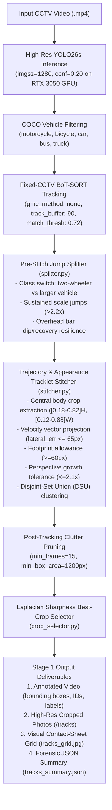

# Team Invictus — Vehicle Identification & Traceability (AIML-01)

[](https://hackasol.devpost.com/)
[](https://www.python.org/)
[](https://pytorch.org/)
[](https://docs.ultralytics.com/)
[](https://developer.nvidia.com/)

An end-to-end computer vision and deep learning system built for real-world traffic surveillance, forensic vehicle traceability, and continuous multi-vehicle tracking across complex urban intersections and highways.

---

## 📑 Living Documentation Suite

To maintain transparency and a persistent engineering audit trail throughout Hack-a-Sol 5.0, three living documentation files track our progress:

- **[challanges.md](file:///c:/Users/arnav/Documents/invictus-vehicle-trace/challanges.md)**: Every real engineering hurdle encountered during development—compute bottlenecks, motion-blur vs. background clutter trade-offs, occlusion ID splits, perspective scale growth, dense-lane identity jumping, and overhead gantry bar occlusions.
- **[solutions.md](file:///c:/Users/arnav/Documents/invictus-vehicle-trace/solutions.md)**: Technical specifications, mathematical formulations, algorithms, and empirical verification results for each resolved challenge.
- **[changes.md](file:///c:/Users/arnav/Documents/invictus-vehicle-trace/changes.md)**: Chronological changelog with exact timestamps documenting repository milestones, pipeline iterations, and test runs.

---

## 🎯 Problem Statement (Track AIML-01)

Traffic monitoring and law enforcement agencies face severe challenges when tracking vehicles through congested CCTV feeds:
1. **Broken Identities**: Vehicles passing behind buses or crossing traffic disappear temporarily, causing standard trackers to assign new identity numbers when they emerge.
2. **Identity Jumping**: In dense parallel lanes, tracks frequently hop onto adjacent vehicles of similar color or size.
3. **Environmental Occlusions**: Overhead gantry poles, traffic lights, and tree branches momentarily clip bounding boxes, fragmenting vehicle traces.
4. **Scale Dynamics**: Vehicles approaching fixed CCTV cameras grow up to $2\times$ in size, defeating naive scale-matching thresholds.

**Invictus Vehicle Trace** solves these challenges using a multi-stage architecture combining high-resolution GPU-accelerated detection, tuned fixed-CCTV tracking, pre-stitch anomaly splitting, and trajectory-projected spatiotemporal stitching.

---

## 🏗️ Stage 1 Architecture



---

## 🚀 Key Technical Innovations

1. **Hardware-Accelerated Throughput**:
   - Built on PyTorch 2.6.0 with CUDA 12.4 on an NVIDIA GeForce RTX 3050 Laptop GPU.
   - Achieves **45–60 FPS** inference speed at full 1080p resolution ($15\times$ faster than CPU).

2. **Decoupled Sensitivity & Selectivity**:
   - Low detector threshold (`conf=0.20`) and high resolution (`imgsz=1280`) ensure motion-blurred two-wheelers remain attached to tracks.
   - Decoupled post-tracking filter (`min_frames=15`, `min_box_area=1200px`) eliminates background noise without sacrificing target continuity.

3. **Pre-Stitch Anomaly Splitter (`splitter.py`)**:
   - Eliminates identity jumping across lanes by immediately splitting tracks if a vehicle switches between two-wheeler and four-wheeler classes.
   - Distinguishes 1-frame overhead bar occlusion dips from true sustained scale anomalies.

4. **Trajectory-Projected & Central-Body Stitcher (`stitcher.py`)**:
   - **Central Body Region**: Compares the inner $64\% \times 76\%$ crop of each vehicle to avoid roof-level gantry bars, windshield glare, and ground shadows.
   - **Trajectory Projection**: Projects where a vehicle should be at reappearance using its forward velocity vector $\vec{v}_A$, strictly enforcing $\text{lateral\_err} \le 65\text{px}$ to eliminate cross-lane swaps.
   - **Footprint Centroid Allowance**: Accommodates boundary expansions ($\ge 60\text{px}$) when emerging from occlusions without tripping velocity ceilings.
   - **Perspective Scaling**: Accommodates natural camera approach growth up to $2.1\times$ for identical vehicle classes.

5. **Automated Forensic Contact Sheet (`grid_generator.py`)**:
   - Generates a high-resolution overview grid (`tracks_grid.jpg`) featuring the sharpest frame crop, unique master ID, vehicle class, and active timestamp for every tracked vehicle.

---

## 📊 Stage 1 Benchmark Results

| Scenario / Video | Resolution & FPS | Track Count | Verified Target Outcomes |
| :--- | :---: | :---: | :--- |
| **`activa_signal.mp4`** (Urban Intersection) | 1080p @ 30 FPS | 29 | Moving white Activa maintains **Track 27** across the entire intersection crossing (`[27, 38, 51]`); stationary Activa maintains **Track 4** across all 300 frames. |
| **`highway_traffic.mp4`** (Multi-Lane Highway) | 1080p @ 30 FPS | 88 | Vehicles passing under horizontal overhead gantry bar cleanly stitch (`39-66`, `49-95`, `55-90`, `56-87`, `61-91-93`, `63-96-98`). Parallel cross-lane swaps strictly rejected. |
| **`simple_traffic_30s.mp4`** (General Traffic Stress Test) | 1080p @ 30 FPS | 144 | 57 merge events consolidated across 34 multi-segment tracks; zero ID jumping across cars, trucks, buses, and motorcycles. |

---

## 🛠️ Usage & Execution

### Prerequisites
- Windows 11 / Linux with NVIDIA GPU (CUDA 12.x supported)
- Python 3.10+
- Virtual environment with dependencies installed:
  ```bash
  pip install torch torchvision --index-url https://download.pytorch.org/whl/cu124
  pip install ultralytics opencv-python numpy pyyaml
  ```

### Running the Tracking Pipeline
```bash
# Run on default clip (activa_signal.mp4)
python scripts/run_tracking.py

# Run on a custom video with specific outputs
python scripts/run_tracking.py \
  --video data/clips/highway_traffic.mp4 \
  --output-dir outputs/highway_traffic \
  --output-video highway_traffic_tracked.mp4 \
  --device 0 \
  --imgsz 1280 \
  --conf 0.20 \
  --max-gap 2.5 \
  --max-lateral-err 65.0
```

### Command-Line Options
| Argument | Default | Description |
| :--- | :---: | :--- |
| `--video` | `data/clips/activa_signal.mp4` | Path to input CCTV video file |
| `--output-dir` | `outputs` | Target directory for outputs |
| `--output-video` | `<stem>_tracked.mp4` | Filename of annotated output video |
| `--device` | `0` (CUDA) | Compute device (`0`, `cuda`, or `cpu`) |
| `--imgsz` | `1280` | YOLO inference image size (pixels) |
| `--conf` | `0.20` | Detection confidence threshold into tracker |
| `--min-frames` | `15` | Minimum active frames for vehicle persistence filter |
| `--min-area` | `1200` | Minimum bounding-box area in pixels |
| `--max-gap` | `2.5` | Maximum occlusion gap in seconds for stitching |
| `--max-speed` | `450.0` | Maximum vehicle velocity in px/s |
| `--max-size-ratio` | `2.1` | Maximum bounding-box scale ratio for perspective growth |
| `--max-lateral-err` | `65.0` | Maximum cross-lane lateral error from trajectory projection |

---

## ⚖️ Hack-a-Sol 5.0 Disclosures & Compliance

In strict adherence to the **Hack-a-Sol 5.0 Rules & Code of Conduct**, we provide full attribution for all open-source libraries, pre-trained weights, test footage, and AI assistance:

### 1. Pre-Trained Models
- **YOLO26s**: [Ultralytics YOLO](https://github.com/ultralytics/ultralytics) (Pre-trained on COCO dataset, 80 classes, filtering classes `1: bicycle, 2: car, 3: motorcycle, 5: bus, 7: truck`).
- **BoT-SORT**: Built-in BoT-SORT multi-object tracker with native feature extraction (modified for fixed-CCTV operation in `cv_pipeline/botsort_reid.yaml`).

### 2. Video Footage Sources
- Test clips downloaded and extracted from publicly available traffic surveillance video on YouTube:
  - `activa_signal.mp4` & `intersection_traffic.mp4`: [QA-POV YouTube Channel](https://www.youtube.com/watch?v=_5nGL47gNzo)
  - `highway_traffic.mp4`: [QA-POV Highway Traffic Clip](https://www.youtube.com/watch?v=tQnVX3nj3Co)
- Videos are used strictly for non-commercial academic research and benchmarking in compliance with fair use principles.

### 3. AI Coding Tools Disclosure
- **Antigravity IDE & Agentic Assistant (Google DeepMind)**: Used for architecture brainstorming, script execution, automated debugging, and test evaluation.
- All generated code has been reviewed, analyzed, debugged, and verified by Team Invictus.
